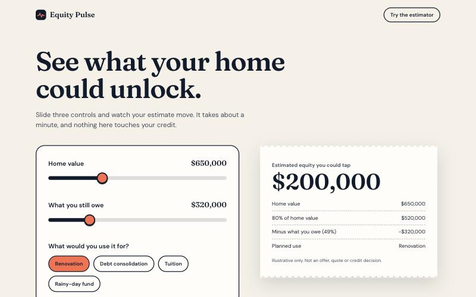
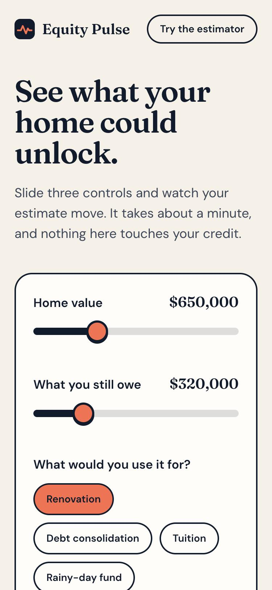
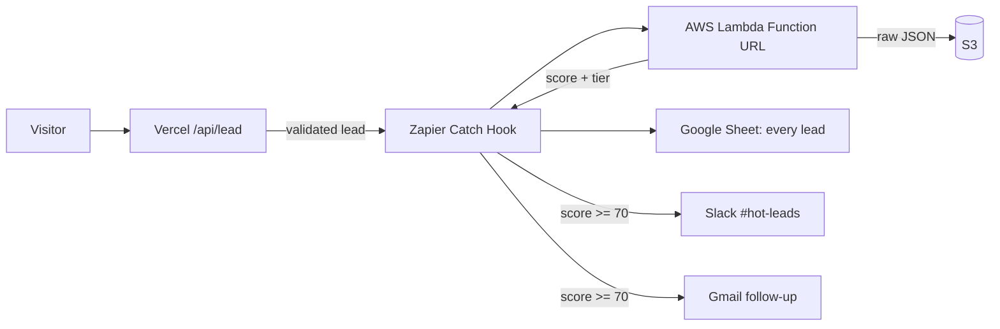

# Equity Pulse

A mobile-first landing page for a home-equity offer, wired to a small lead-automation pipeline: **Vercel → Zapier → AWS Lambda → Google Sheets → Slack → Gmail**.

**Live demo:** https://equity-pulse-rho.vercel.app

> **Disclaimer:** an independent concept project, built as a portfolio piece. Not a lender, not affiliated with any lender, no real rates or offers. Estimates are illustrative. Use fake test data only.

<p>
  
  
</p>

## The problem it solves

A paid-campaign visitor who gets an instant, believable number is more likely to leave details. A lead who is ready to act should reach a human in minutes, not sit in a spreadsheet. This project does both: an estimator that earns the lead, and an automation that scores it and routes it.

## What happens when someone submits the form

1. **Vercel / Next.js** validates the lead on the server, drops bots with a honeypot field, recomputes the estimate server-side (so it cannot be spoofed) and forwards it to Zapier. If Zapier is down the visitor still sees success.
2. **Zapier** catches the webhook and calls the **AWS Lambda** through a Function URL, with a shared-secret header.
3. **Lambda** scores the lead (0 to 100), writes the raw JSON to **S3**, and returns the score and tier.
4. **Zapier** adds a **Google Sheet** row for every lead, then a filter lets only **hot leads (score 70 or more)** continue to a **Slack** alert and a personalised **Gmail** follow-up.



More detail: [docs/architecture.md](docs/architecture.md).

## Lead scoring

A lead is **hot at 70 or more**. The weights favour intent and reachability over raw size.

| Signal | Points |
| --- | --- |
| Estimated equity $100k or more / $50k or more / below | 30 / 20 / 10 |
| Goal: renovation or debt consolidation / other | 20 / 10 |
| Timeline: this month / this quarter / later | 25 / 15 / 0 |
| Phone with at least 7 digits | 15 |
| Valid, non-disposable email | 10 |

## Weekly report

A second Zap runs every Monday at 9:00 (Asia/Kolkata). It reads one summary row from the **Report** tab of the Google Sheet (formulas for total leads, hot leads, hot rate, average score, leads in the last 7 days and top source, plus a lead and score breakdown by A/B variant) and posts it to Slack. Reporting comes from the same Sheet the leads land in, so the numbers cannot drift from the source.

## Design decisions

- **Shared secret, no API Gateway.** The Lambda Function URL is public but rejects requests without the `x-equity-pulse-secret` header, compared in constant time. Simpler and cheaper than API Gateway for a single caller.
- **Least-privilege IAM.** The Lambda runs as a dedicated role that can only `s3:PutObject` under `leads/*` in one bucket. No long-lived AWS keys anywhere.
- **Failure isolation.** The website never depends on Zapier or AWS being up. A failed webhook is logged and the visitor still succeeds.
- **PII hygiene.** Emails are masked in logs. Demo data is fake.
- **One orchestrator, one job per tool.** Zapier is the only place workflows live. AWS holds only the scoring logic and raw record, which Zapier cannot do safely. The Sheet is the human-readable log and report source.
- **Server-side truth.** Validation and the estimate are computed on the server, never trusted from the browser.

## Known limitations and next steps

Found in the review pass and left as deliberate trade-offs for a demo:

- **A webhook failure loses the lead.** If Zapier is down the visitor still sees success (by design, so the page never breaks), but the lead only exists in a masked log line. Production fix: persist the lead first (queue or KV) and forward asynchronously with retries, or return a retryable error.
- **No rate limiting.** The honeypot stops naive bots only. Production fix: per-IP rate limits plus a bot challenge such as Cloudflare Turnstile.

Fixed after the review: server-side form errors rendering correctly, keyboard focus visible on the dark form, body size measured on the actual bytes, junk phone numbers no longer earning points, spreadsheet-formula prefixes stripped from free text, scoring fields in S3 not client-controllable, and disposable-domain matching covering subdomains.

## Analytics and QA

- **Google Analytics 4** loads only when `NEXT_PUBLIC_GA_ID` is set. Events: `lead_form_start` and `generate_lead` (value = estimate, plus goal, timeline and variant). No personal data is ever sent to analytics.
- **QA checklist:** [docs/qa-checklist.md](docs/qa-checklist.md) is the standard procedure for checking the page and the pipeline, with a table of test leads and expected results.

## Tech

Next.js 16 (App Router), TypeScript, Tailwind v4, Framer Motion, Zod, Vitest. AWS Lambda (Node.js 22) with a Function URL and S3. Zapier for orchestration. Hosted on Vercel.

## Tests

```bash
npm install
npm test          # estimate maths, lead schema, Lambda scoring and handler
npm run lint && npm run typecheck
```

Needs Node 20 or newer (Node 22 recommended).

## Run locally

```bash
cp .env.example .env.local   # optionally set ZAPIER_WEBHOOK_URL
npm run dev
```

Without `ZAPIER_WEBHOOK_URL` the API route logs the lead (email masked) and still returns success.

## Lambda

See [aws/lambda/README.md](aws/lambda/README.md) for the handler contract, environment variables, IAM policy and console deploy steps.

## How it was built

Built with Claude Code as a pair-programmer, followed by an independent second review pass over the code.

## Estimate formula

`max(0, 0.80 x homeValue - mortgageBalance)`, rounded to the nearest $1,000 (an illustrative 80% combined loan-to-value rule).

## Credits

Fonts: Fraunces and DM Sans via Fontsource, SIL Open Font License. Code: MIT.
