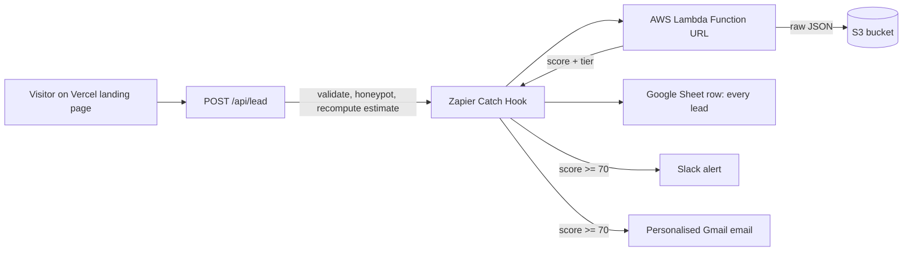

# Architecture and lead scoring

## Lead payload

`source, leadId, receivedAt, name, email, phone, timeline, goal, homeValue, mortgageBalance, estimate, utm_source, utm_medium, utm_campaign, variant`

## Scoring (hot lead at 70 or more)

| Signal | Points |
| --- | --- |
| Estimated equity $100k or more / $50k or more / below | 30 / 20 / 10 |
| Goal renovation or debt consolidation / other | 20 / 10 |
| Timeline this month / this quarter | 25 / 15 |
| Phone with at least 7 digits | 15 |
| Valid, non-disposable email | 10 |

## Safety choices

Honeypot field, server-side validation, estimate recomputed on the server, 10 kB body cap, webhook call with an 8 second timeout inside try/catch (the visitor still sees success if the webhook is down), emails masked in logs, no long-lived AWS keys.

## Weekly report

Second Zap: Schedule (Mon 9:00 Asia/Kolkata) -> Google Sheets lookup of the `Report` tab summary row -> Slack message in #hot-leads.
